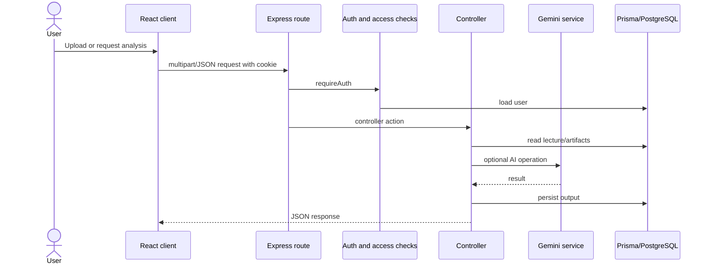

# Backend guide and workflows

## Startup and request lifecycle

`server/src/server.js` configures credentialed CORS, cookie-parser, JSON/URL-encoded parsers (100 MB), development request logging, mounts `routes/index.js` at `/api`, then adds API 404 and global `errorHandler`. It listens only when executed directly and `NODE_ENV !== 'test'`; SIGINT/SIGTERM close the server. `config/env.js`, `config/prisma.js` and `utils/logger.js` provide configuration, DB client and logging.

Routes bind HTTP verbs to controllers. Controllers validate requests, enforce ownership/membership, use Prisma and domain services, then return JSON. `middleware/auth.js` accepts HTTP-only cookie or Bearer JWT, verifies it, reloads a safe user projection and sets `req.user`. `optionalAuth` continues anonymously if token is absent/invalid. `middleware/upload.js` configures Multer; `errorHandler.js` handles uncaught errors.

## Main modules

| Module | Responsibility |
|---|---|
| `controllers/auth.controller.js` | Registration, login/logout, profile and reset OTP |
| `controllers/lecture.controller.js` | Lecture/artifact CRUD, access checks, orchestration, export/chat |
| `controllers/subject.controller.js` | Subjects, membership, invite workflows |
| `controllers/payment.controller.js` | Packages, purchase verification, credits/history |
| `controllers/ai.controller.js`, `health.controller.js` | Diagnostics |
| `services/gemini/*` | Client, transcription, summary, analysis, concepts, relationships, maps, RAG and error normalization |
| `services/{db,email,esewa}.service.js` | DB helper, SMTP and gateway integration |
| `utils/auth.js` | Password/JWT/cookie helpers |

## Workflows

### Authentication
Registration validates nonblank name, simple email regex and password length ≥6, normalizes email, checks uniqueness, bcrypt-hashes password, and transactionally creates User plus 10-credit `INITIAL_BONUS`; it then issues cookie and returns user/token. Login checks hash and issues JWT. `/me` returns safe middleware user; logout clears cookie. Forgot-password creates a six-digit OTP, stores SHA-256(email:OTP) hashes (up to two) with 15-minute expiry, and sends mail through email service. Verify checks hash/expiry; reset hashes new password and clears reset data.

### Lecture and AI workflow
All lecture routes require auth. Creation/transcription use Multer. Controller applies ownership or subject membership checks, calls separate Gemini services, and stores transcript, summary, concepts, relationships and map in Prisma models. RAG chunks the transcript, embeds passages with Gemini Embeddings, stores vectors in PostgreSQL/pgvector, embeds each question, unions nearest-vector and PostgreSQL full-text candidates, then reranks them together. The generator sees retrieved transcript evidence only; citation IDs are resolved to stored passages on the server. A transcript fingerprint makes chat rebuild an outdated index after edits. Bookmarks and export are controller operations. No object-storage adapter is evident: `audioUrl` and `storagePath` are schema fields but do not themselves provide storage.

### Subjects and payments
Subject creation transactionally creates subject and TEACHER membership. Listing is restricted to teacher/member; detail checks membership; invite preview is optional-auth; join adds membership; deletion is controller-authorized. Payment controller/service initiate eSewa transactions and verify gateway response before crediting and recording transactions. Verify the actual controller transaction boundaries before changing settlement behavior.

## Errors and operations

Controllers generally catch/log errors and return `{success:false,error:{message}}`; statuses differ per handler. Development logs method/URL; no production monitoring, worker, queue or scheduled job was found.
