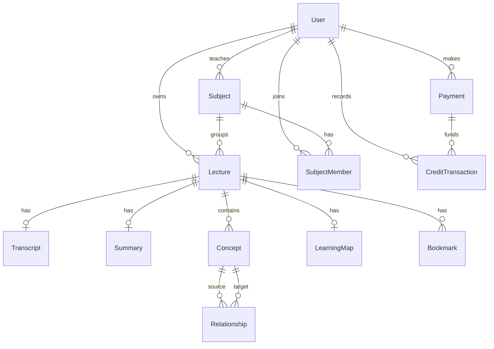

# Database schema and lifecycle

`server/prisma/schema.prisma` uses PostgreSQL with `DATABASE_URL` and `DIRECT_URL`. Migrations are in `server/prisma/migrations/`, including the initial schema and the transcript pgvector index. Backups, retention and recovery are not configured in the checked-in project.

| Model/table | Key fields and integrity |
|---|---|
| User / users | cuid PK, unique email, passwordHash, optional unique reset token/expiry, credits default 10 |
| Subject / subjects | name, code, description, color, teacherId, unique inviteCode; teacher cascade |
| SubjectMember / subject_members | subjectId,userId,role,joinedAt; unique pair; both parent FKs cascade |
| Lecture / lectures | owner, optional subject, title/audio metadata/status/duration/date; owner cascade, subject SetNull; indexes for owner/subject/date/status |
| Transcript / transcripts | unique lectureId, text content, optional JSON segments; lecture cascade |
| Summary / summaries | unique lectureId, text content; lecture cascade |
| Concept / concepts | lectureId,name,description,importance; lecture cascade |
| Relationship / relationships | lecture/source/target IDs, type, description; all cascade, indexes on IDs |
| LearningMap / learning_maps | unique lectureId, JSON mapData; lecture cascade |
| Bookmark / bookmarks | lectureId,title,note,timestamp,transcriptPosition; lecture cascade |
| TranscriptChunk / transcript_chunks | lectureId, chunkIndex, passage content, optional source segment/time metadata, transcript fingerprint, embedding model and pgvector(1536); lecture cascade, unique lecture/chunk index |
| Payment / payments | user, amount, credits, unique transactionUuid, gateway ref/status/raw JSON; user cascade |
| CreditTransaction / credit_transactions | user, signed amount,balanceAfter,type,description, optional lecture/payment IDs; payment SetNull |

IDs are cuid strings in Prisma-created records; RAG chunk rows use UUID text IDs generated by Node. Role/status/type values are plain strings, not enums. JSON stores transcript segments, map and raw gateway response. Transcript embeddings use Gemini Embeddings and PostgreSQL's `vector` extension; Prisma accesses vector data through parameterized raw SQL because the schema type is `Unsupported`. No explicit check constraints are visible in Prisma schema.

Registration creates User and initial credit ledger entry in one transaction. Lecture artifact relations cascade when lecture is deleted. Subject deletion cascades memberships and sets a lecture's subject null. Controller access rules enforce ownership/membership; foreign keys alone do not provide tenant isolation. Credit/payment transaction guarantees must be reviewed in payment controller. No RLS, backup, or retention policy is configured here.
