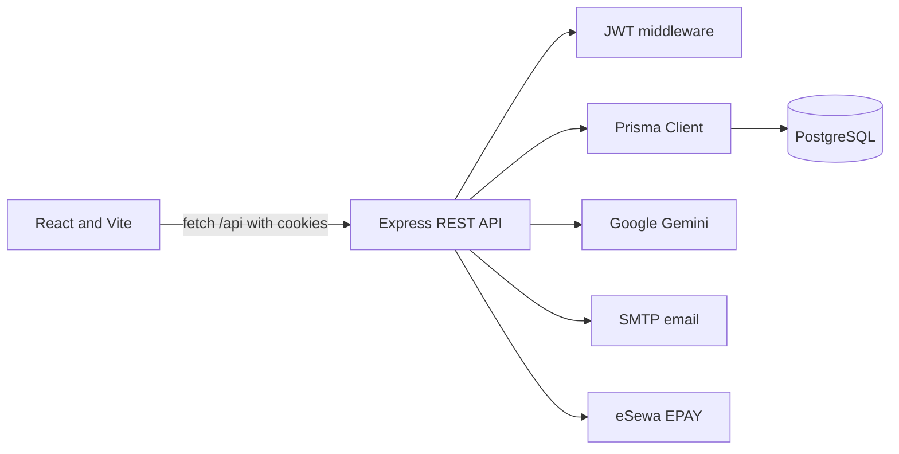

# Project overview and architecture

LectureMind turns classroom audio into transcripts, summaries, concepts, relationships and interactive learning maps. Users manage lectures personally or in shared subjects; Gemini powers AI operations. Credit top-ups use eSewa.

## Responsibilities and execution

The client handles presentation, URL routing, auth/theme state and requests. The server applies business rules and authorization, persists through Prisma, and calls AI/email/payment integrations. The schema targets PostgreSQL; README mentions Neon, but actual host is determined by connection URLs.

`client/src/main.jsx` mounts React StrictMode and BrowserRouter. `App.jsx` nests theme/auth providers and declares routes. AuthProvider checks `/api/auth/me` on mount. `client/src/services/api.js` wraps fetch, includes credentials, parses JSON and throws enriched errors. `server/src/server.js` initializes CORS, cookies, body parsers, development logging, `/api` routes, API 404 and error middleware.

## Feature inventory

1. Landing, registration, sign-in/out and OTP password reset.
2. Lecture upload/library/detail/delete, transcription and transcript editing.
3. Gemini summaries, concept extraction, relationships and editable learning maps.
4. Lecture-grounded chat with citations/suggested questions.
5. Bookmarks and multi-format lecture export.
6. Subject/classroom creation, invites, membership and subject lecture views.
7. Credits, history and eSewa payment initiation/verification.
8. Health/AI diagnostics and theme selection.

Source implementation is authoritative; script names and README claims are not proof. No worker, queue or scheduled job was found.

## Technology inventory

| Technology | Manifest range/provider | Project use |
|---|---|---|
| React/React DOM | `^18.3.1` | UI |
| React Router DOM | `^6.29.0` | SPA routes |
| Vite/plugin-react | `^5.4.14` / `^4.3.4` | Client build/dev |
| Tailwind CSS | `^3.4.17` | Styling |
| Node.js / Express | Express `^4.21.2`; Node unpinned | ES module REST API |
| Prisma / Client | `^5.22.0` | PostgreSQL ORM |
| PostgreSQL | Prisma provider | Persistent store |
| Google Generative AI SDK | `^0.21.0` | Gemini calls |
| bcryptjs / jsonwebtoken | `^3.0.3` / `^9.0.3` | Password hashing / sessions |
| Multer / Nodemailer | `^2.3.0` / `^10.0.0` | Audio multipart / SMTP |
| eSewa EPAY v2 | External | Credit payment |
| lucide-react | `^0.475.0` | Icons |

These are package ranges, not asserted installed versions. No dedicated test framework is declared. See [setup](setup.md) for scripts/configuration and [integrations](integrations.md) for external boundaries.
